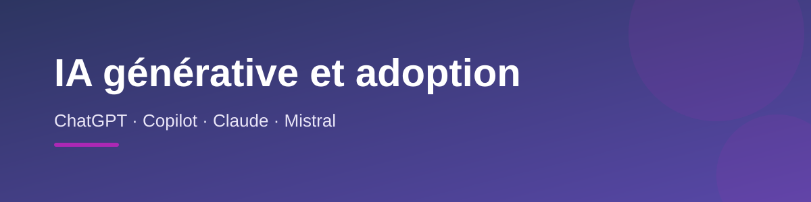
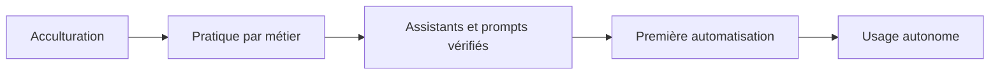
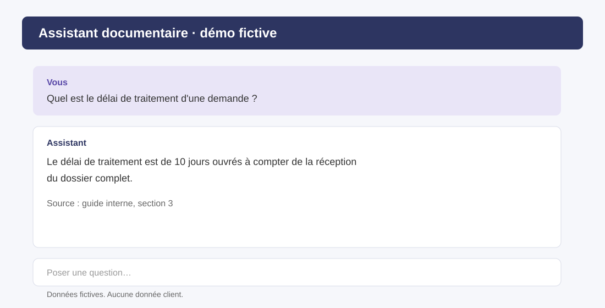

# IA générative et adoption

Faire passer une équipe de l'usage occasionnel de ChatGPT à des usages maîtrisés et utiles.

*Generative AI adoption: ChatGPT, Microsoft 365 Copilot, Claude and Mistral, from awareness to practice.*

## Ce que je peux faire pour vous

- **Conseil** : diagnostic des usages, cadrage, choix des outils, règles de confidentialité.
- **Automatisation** : assistants personnalisés, première automatisation, mode agent.
- **Formation** : acculturation, parcours par métier, pratique sur les cas de l'équipe.

## Cas 1 · parcours inter-entreprises de 5 jours

### Contexte

Un parcours inter-entreprises en Bretagne, pour des profils mixtes : assistanat, RH, PMO, dirigeant, formateur. L'objectif : partir de l'usage de ChatGPT et arriver à des workflows simples.

### Intervention

Formation, 5 jours, hybride, deux groupes. 2026.

### Démarche

1. Acculturation et usages par métier.
2. Pratique guidée, vérification et assistants personnalisés.
3. Première automatisation avec n8n.

### Résultat

- Un fil rouge commun.
- Des usages adaptés à chaque métier.
- Une première automatisation comprise par tous.

### Point dur surmonté

Les niveaux étaient très différents. Un socle commun a été posé, puis des variantes « mon cas » et « pour aller plus loin ».

## Cas 2 · Copilot pour un opérateur public

### Contexte

Un opérateur public veut équiper ses équipes de Microsoft 365 Copilot et éviter les usages non maîtrisés.

### Intervention

Formation et accompagnement, plusieurs sessions, en 2026.

### Démarche

1. Cadrer les usages et les données sensibles.
2. Former par métier, sur des documents fictifs.
3. Mettre en place des règles simples de vérification.

### Résultat

- Des équipes formées.
- Des usages encadrés.
- Des règles de confidentialité comprises.

### Point dur surmonté

Les métiers avaient des attentes très différentes. Les sessions ont été adaptées par profil, avec un tronc commun.

## Cas 3 · journée fondamentaux ChatGPT

### Contexte

Un groupe de débutants veut comprendre ChatGPT et l'utiliser sur des tâches de bureau, sans exposer de données sensibles.

### Intervention

Formation, 1 jour, en 2026.

### Démarche

1. Partir des tâches réelles des participants.
2. Pratiquer les prompts, la vérification et les limites.
3. Terminer par une première automatisation simple.

### Résultat

- Des usages compris et testés.
- Des règles de confidentialité.
- Une base commune pour la suite.

### Point dur surmonté

Les participants avaient des attentes très différentes. Un socle commun a été posé, puis des variantes par métier.

## Idées de prompts

- « Résume ce document en cinq points, puis liste ce qui n'est pas dans le texte. »
- « Prépare un ordre du jour de 45 minutes à partir de ces notes, avec trois décisions à prendre. »
- « Compare ces deux options sur cinq critères et signale les critères où l'information manque. »
- « Réécris ce message pour un public non technique, en gardant les chiffres et les sources. »
- « Fais-moi un quiz de cinq questions sur ce document, avec les réponses et les pages. »

## Architecture

## Captures de démos fictives

## Autres formats

- Journée « fondamentaux ChatGPT » pour un groupe débutant.
- Atelier Copilot pour une équipe projet, sur ses propres documents.
- Parcours de 5 jours pour des profils mixtes.

## Me contacter

- Site : https://next-gen-ai.fr
- LinkedIn : https://www.linkedin.com/in/adam-ai-011540356

---

*Tous droits réservés. Le contenu de ce dépôt ne peut être reproduit sans accord écrit.*
